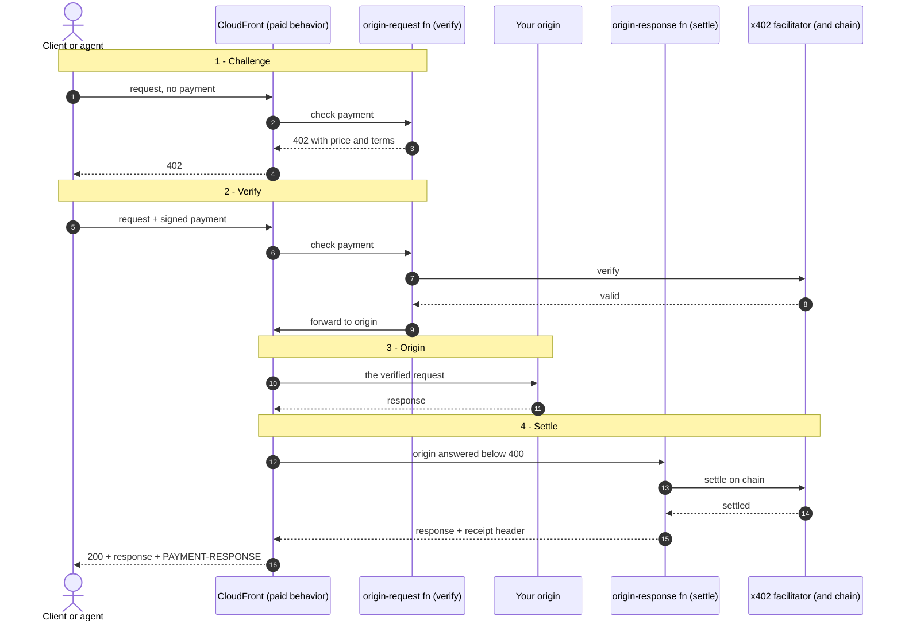
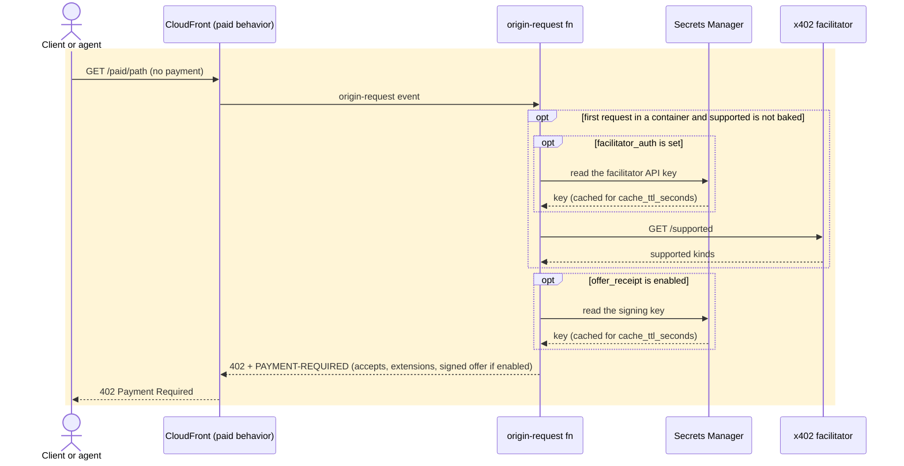
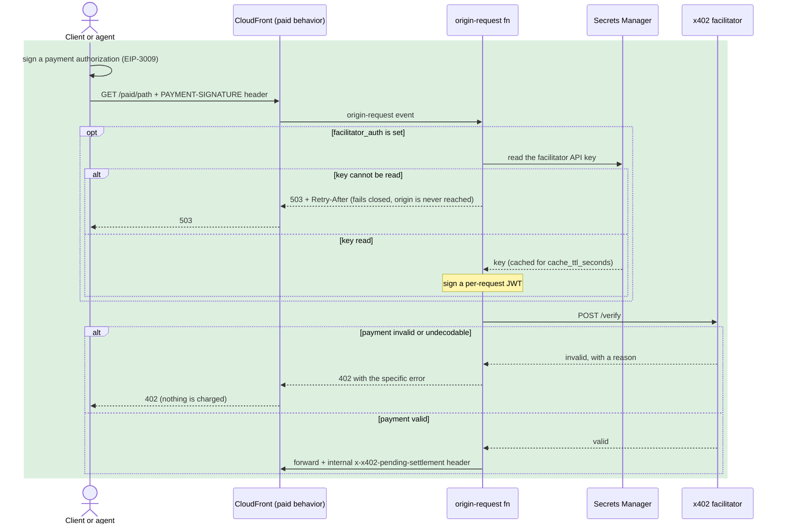
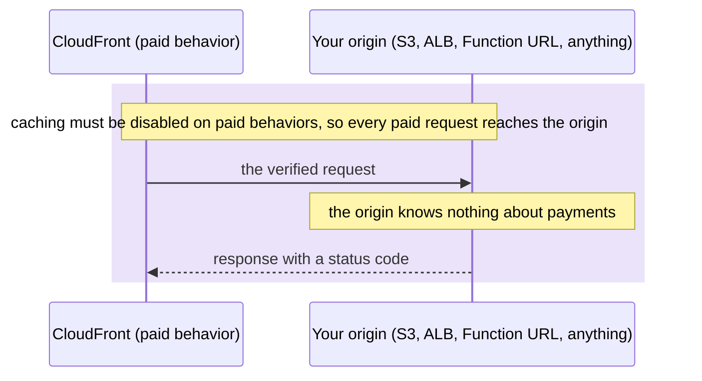
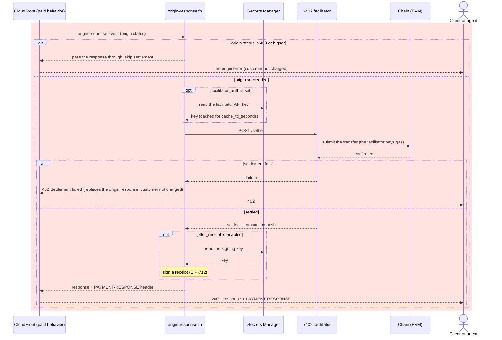

# Request flow

What the two Lambda@Edge functions do on a paid route, phase by phase, and where each optional module feature appears. Optional steps are drawn as `opt` blocks labelled with the variable that enables them, so you can see what your configuration adds.

- [Overview](#overview)
- [Phase 1 - Challenge](#phase-1---challenge-the-unpaid-402)
- [Phase 2 - Verify](#phase-2---verify-the-paid-retry)
- [Phase 3 - Origin](#phase-3---origin)
- [Phase 4 - Settle](#phase-4---settle)
- [Facilitator configurations](#facilitator-configurations)
- [Cold starts and tuning](#cold-starts-and-tuning)

The four phases keep the same color in every diagram. The fills are translucent, so the diagrams read the same in light and dark mode.

## Overview

`origin-request` and `origin-response` are two separate Lambda@Edge functions, each run in the AWS region nearest the viewer. A single request can reach them in different containers, one warm and one cold. The module is stateless: nothing is remembered between verify and settle except the internal `x-x402-pending-settlement` request header that carries the verified payment from the first function to the second.

## Phase 1 - Challenge: the unpaid 402

The client asks without paying and learns the price and terms. Nothing is charged, and your origin is not called. A client that already knows the terms can skip this phase and send `PAYMENT-SIGNATURE` on its first request.

The first `opt` block is the cold-start cost of a facilitator that is not baked: the first request in each container fetches `/supported`, and with `facilitator_auth` it must read the API key first. Setting `supported_json` removes that call. The second `opt` only exists when `offer_receipt` is enabled.

## Phase 2 - Verify: the paid retry

The client signs an authorization and retries. The edge checks it with the facilitator before your origin runs. Nothing is charged at this stage.

With `facilitator_auth`, the key is read at runtime and never stored in the deployment package. If it cannot be read, the request fails closed with a 503 and the origin is never reached. A malformed or invalid payment gets a 402 whose `error` says what was wrong.

## Phase 3 - Origin

CloudFront forwards the verified request to your origin, which needs no payment code. Caching must stay disabled on paid behaviors (use the module's `cache_policy_id` output), because `origin-request` only runs on a cache miss and a cached paid response would be served without verification.

## Phase 4 - Settle

Settlement happens only if the origin answered below 400, so a failing origin never charges the client. A failure at settle time (including an error thrown while settling) returns a 402 `Settlement failed` that replaces the origin's response, and the client is not charged.

`origin-response` is a different function from `origin-request`, so an unpaid 402 does not warm it. The first paid request in a region pays its cold start.

## Facilitator configurations

The diagrams are the same for every facilitator. What changes is which optional steps appear.

| Configuration | Variables | What it adds to the flow |
|---|---|---|
| Facilitator without auth (for example `https://facilitator.payai.network`, `https://x402.org/facilitator`) | `facilitator_url` | Nothing extra. No secret reads and no JWT. |
| Keyed facilitator (Coinbase CDP) | `facilitator_url`, `facilitator_auth` | A Secrets Manager read in phases 1 (cold), 2 and 4, and a per-request JWT. Unreadable key means a 503 in phase 2. |
| `/supported` fetched live (default) | none | A `GET /supported` on the first request in each container (phase 1 diagram). |
| `/supported` baked at plan time | `bake_supported = true` | Removes the live call. Works only for a facilitator that needs no auth. |
| `/supported` supplied by you | `supported_json` | Removes the live call, also with `facilitator_auth`. A deploy-time snapshot: update it if the facilitator changes what it advertises. |
| Signed offers and receipts | `offer_receipt` | Signing-key read in phase 1, and a signed receipt in the phase 4 response. |
| Replica secret reads | `secret_replica_reads = true` | Secret reads go to a replica in the execution region first, then to the region in the ARN. Replicate the secret to the regions you serve before enabling it. |

## Cold starts and tuning

A container's first request does extra work: runtime init, reading secrets, and (unless baked) `GET /supported`. Warm requests skip all of it, so only the facilitator calls remain. Measurements from one deployment (Coinbase CDP, viewer in Madrid served from eu-central-1, origin Lambda in us-east-1, 2026-11-14 to 2026-11-16):

| Phase | Warm | Cold container |
|---|--:|--:|
| 1 - unpaid 402 | 4 to 10 ms | about 0.44 s (was 1.7 to 3.2 s before the changes below) |
| 2 - verify (`origin-request` total) | 150 to 290 ms | plus the cold items above |
| 3 - origin | depends on your origin (about 0.4 s here, cross-Atlantic hop included) | depends on your origin |
| 4 - settle (`origin-response` total) | 0.63 to 0.88 s | about 1.4 to 1.7 s |

The settle step is the facilitator plus chain confirmation (about 0.75 s) and is the same warm or cold. It is not something the module can speed up.

What moved the cold numbers in that deployment:

- **`memory_size`**: the cold secret read was CPU-bound. Going from 256 MB to 1024 MB cut it from about 1.0 s to about 0.26 s, and the cold 402 from about 1.75 s to about 0.44 s.
- **`supported_json`**: removed the secret read and the `GET /supported` from the unpaid path.
- **`secret_replica_reads`**: saved about 0.2 s when the edge region was far from the secret's region. It matters much less than memory.

These numbers depend on region, memory size, facilitator and origin, so treat them as an example and not a promise. The ordering (memory first, then a baked `/supported`) is the part likely to carry over.
